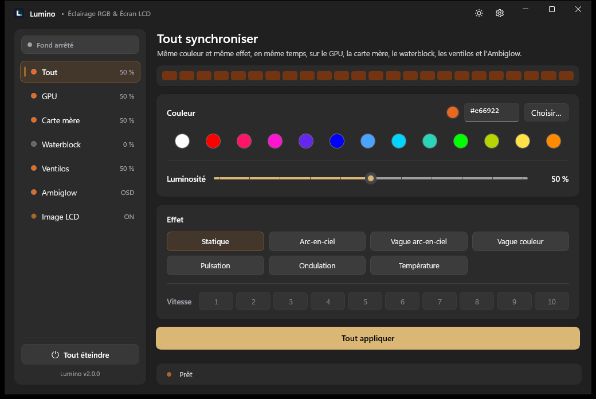

# Lumino

Application Windows 11 (**WinUI 3 / .NET 10**) pour piloter et synchroniser l’éclairage RGB du PC et l’écran LCD Corsair sans iCUE ni suites constructeur.

Aucun prérequis à installer sur un PC Windows 11 vierge (ni Python, ni runtime .NET, ni Windows App Runtime).



## Installation (PC vierge)

Télécharger **`Lumino-Setup-2.0.0.exe`** depuis les [Releases GitHub](https://github.com/yoyo1306/Lumino/releases) et lancer l’installateur :

- Installe `Lumino.exe` dans `C:\Program Files\Lumino` (runtime `.NET 10` et `WinUI 3` embarqués).
- Place l’icône directement à la racine du **Menu Démarrer** (sans sous-dossier ni raccourci Désinstaller ; désinstallation propre via **Paramètres Windows → Applications**).
- Propose un raccourci Bureau optionnel, le réappliquage automatique au démarrage de Windows (`--boot --delay 10`) et l’ajout optionnel au `PATH` (décoché par défaut).
- Arrête proprement toute instance active lors d’une mise à jour et préserve `config.json`.

Les réglages (`config.json`, `lumino.log`, `lcd_media/`) sont stockés dans `%LOCALAPPDATA%\Lumino\` lorsqu’installé dans `Program Files`, ou directement dans le dossier de l’exécutable en mode portable.

## Périphériques & fonctionnalités

| Périphérique | Protocole natif | Fonctions |
|---|---|---|
| **Tout** | Synchronisé | Même couleur, luminosité, effet et vitesse sur tous les appareils en un clic. |
| **GPU** (*Gigabyte RTX 5080 Blackwell*) | `nvapi64.dll` I2C Ex (`0x75`) | 6 zones matérielles, gravage statique, mode direct, vague matérielle et sonde température GPU. |
| **Carte mère** (*ASUS Aura USB*) | USB HID (`0B05:19AF`) | LEDs fixes en statique persistant et animations directes (carte mère + headers ARGB). |
| **Waterblock** (*Corsair iCUE LINK*) | USB HID (`1B1C:0C3F`, `0xFF42`) | Pompe Titan (20 LEDs) + anneau LCD (24 LEDs), maintenu en fond sans iCUE. |
| **Ventilos** (*2× Corsair RX*) | USB HID (`1B1C:0C3F`) | Même effet que le waterblock, couleur et luminosité réglées séparément. |
| **Ambiglow** (*Philips Evnia 27M2N8500*) | DisplayPort DDC (`NvAPI`) + USB WinUSB (`0CF2:A201`) | 8 modes OSD, 14 couleurs, 3 luminosités et 3 vitesses appliqués immédiatement au clic + état USB ENE. |
| **Écran LCD** (*Corsair Elite / LINK Titan*) | USB HID (`0C4E`, paquets 1024 o) | Image fixe, **GIF animé** avec aperçu circulaire temps réel, zoom (`25–200 %`), luminosité (`0–100 %`), mode **Température GPU** et retour au fond matériel. |

### Effets & interface Windows 11
- **7 effets** : `Statique`, `Arc-en-ciel`, `Vague arc-en-ciel`, `Vague couleur`, `Pulsation`, `Ondulation`, `Température` (échelle 30–82 °C), vitesse `1` à `10`, 13 pastilles prédéfinies (palette Ambiglow), sélecteur de couleur natif et saisie `#RRGGBB`.
- **Direction artistique Windows 11** : fond **Mica**, barre de titre personnalisée, thème **Clair / Sombre** mémorisé, instance unique, tiroir **Options** intégré (démarrage Windows, gestion du processus de fond, bascule LCD Température, dossier de données et journal `lumino.log`).

## Ligne de commande (CLI sans interface)

```powershell
Lumino.exe --boot --delay 10   # Réapplique la config sauvegardée au démarrage et lance le fond
Lumino.exe --boot --check      # Vérifie config.json sans rien appliquer
Lumino.exe --corsair-keepalive # Démarre le processus de fond Corsair / Sync / LCD
Lumino.exe --corsair-stop      # Arrête proprement le fond (GPU et CM reviennent au statique)
```

## Architecture des sources

```text
lumino\
    src\
        Lumino.slnx                  solution .NET 10 (x64)
        Lumino.Core\                 NvAPI, Blackwell GPU, ASUS Aura, Corsair LINK/LCD, Ambiglow DDC/WinUSB, effets, keepalive, boot, AppPaths
        Lumino.App\                  interface WinUI 3 (Mica, Options intégrées, aperçu LED & LCD circulaire)
    installer\
        Lumino.iss                   script Inno Setup 6 (Lumino-Setup-2.0.0.exe)
    build.ps1                        publie en self-contained win-x64 et compile l’installateur
    lumino.ico                       icône de l’application
    apercu.png                       aperçu de l’interface Windows 11
    legacy\                          archive des anciens scripts Python v1.2.2
    CHANGELOG.md                     historique des versions
```

## Recompiler

Prérequis de développement : **SDK .NET 10** (`win-x64`) et **Inno Setup 6** (`winget install JRSoftware.InnoSetup`).

```powershell
powershell -ExecutionPolicy Bypass -File .\build.ps1
```

Le script publie `Lumino.exe` (`Release`, `win-x64`, `self-contained`, `WindowsAppSDKSelfContained=true`) dans `publish\`, nettoie les langues satellites inutiles, copie les ressources et génère `dist\Lumino-Setup-2.0.0.exe`.
